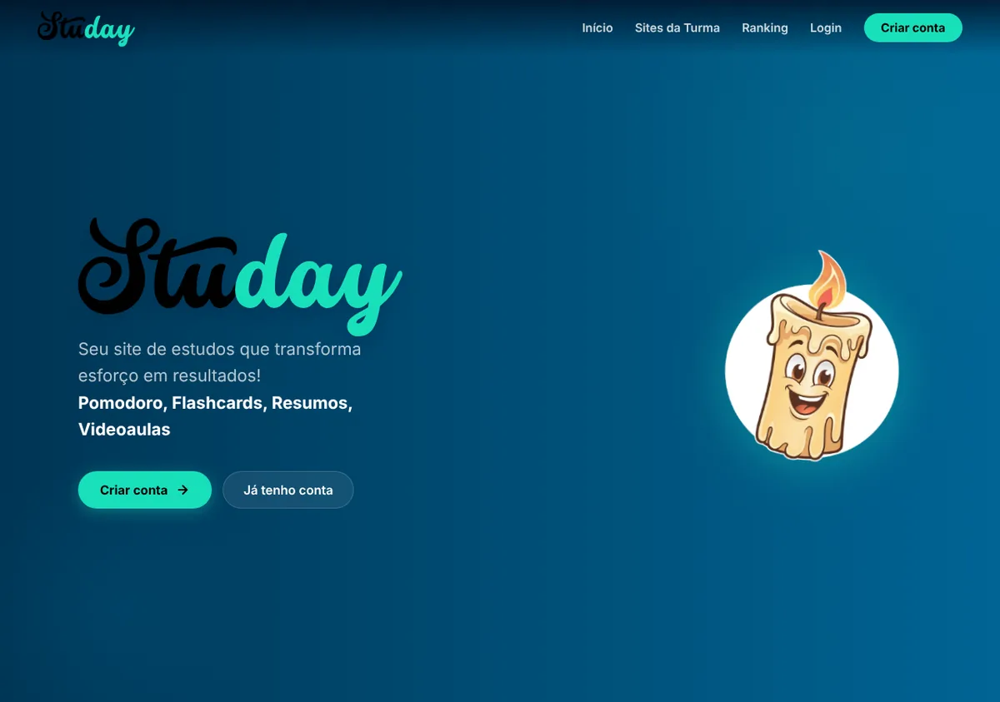
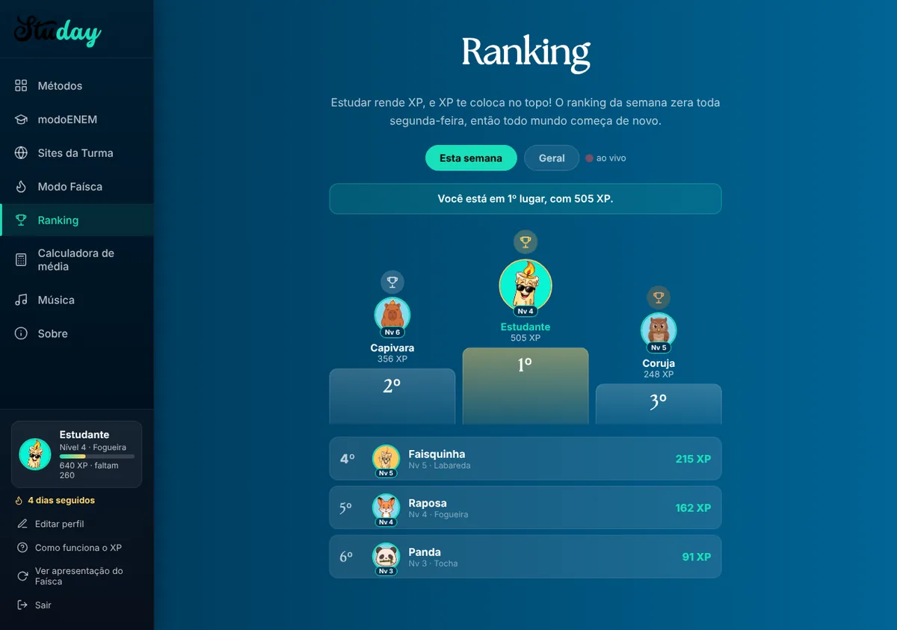
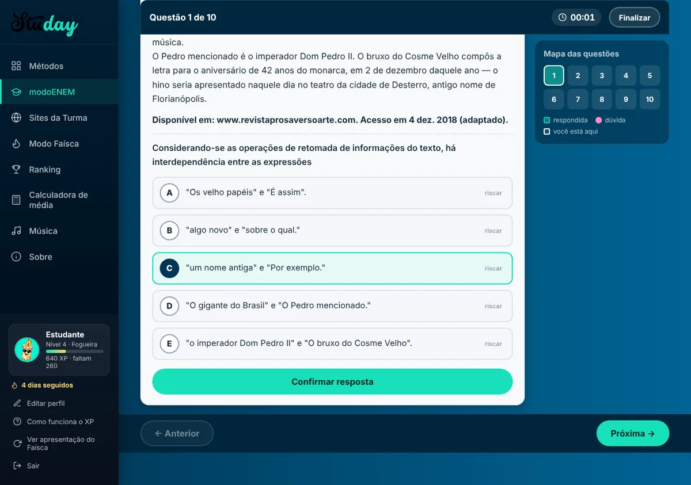
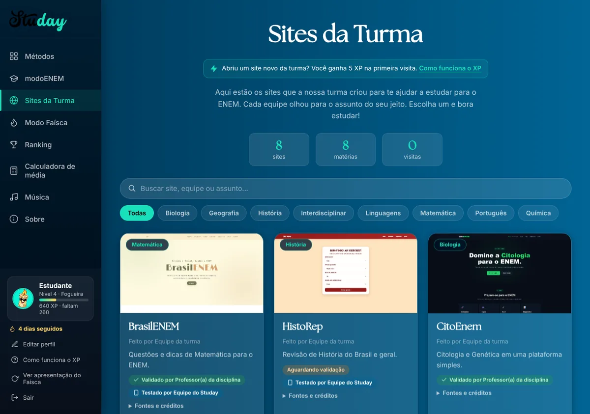
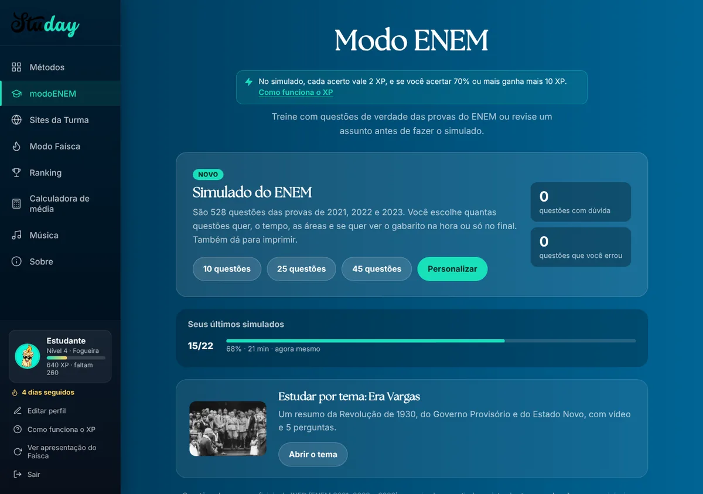
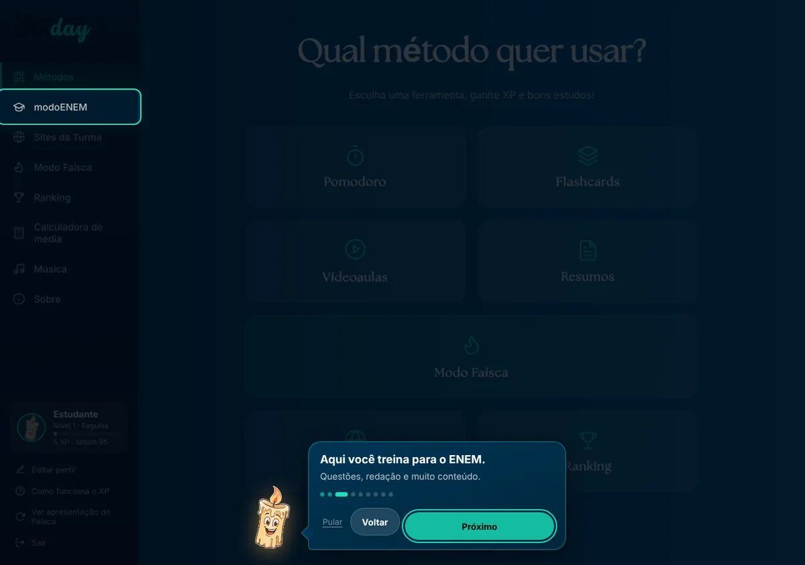
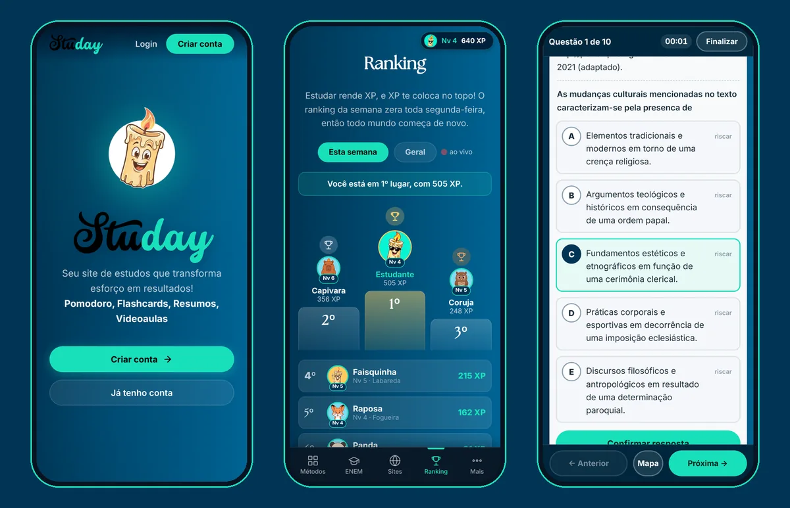

<div align="center">


# Studay

### Plataforma ENEM da turma

**Estude, ganhe XP e suba no ranking.**
Pomodoro, flashcards, resumos, simulados do ENEM e os sites criados pela turma, tudo num só lugar.

<br>


[**Abrir o site**](https://studay.site.je/) &nbsp;·&nbsp; [Funcionalidades](#funcionalidades) &nbsp;·&nbsp; [Equipe](#equipe) &nbsp;·&nbsp; [Como rodar](#como-rodar-no-seu-computador) &nbsp;·&nbsp; [Segurança](#seguranca)

<br>



</div>

---

## Sobre o projeto

O Studay nasceu num dia sem energia elétrica no IFPB Campus Santa Luzia. Sem computador, o grupo esboçou tudo no papel, passou o desenho para o Canva e depois transformou o protótipo em código. O mascote **Faísca**, uma vela sorridente, virou a cara do projeto.

O site começou como um conjunto de ferramentas de estudo feitas só com HTML, CSS e JavaScript. Na última etapa da disciplina ele virou a **Plataforma ENEM**: ganhou banco de dados de verdade, contas, XP, ranking, simulado do ENEM e um portal com os sites que a turma criou.

> **Status:** projeto concluído como atividade da disciplina de Desenvolvimento de Aplicações Web II. O site continua no ar e este repositório fica como registro do trabalho.

---

## Capturas de tela

<table>
  <tr>
    <td width="50%"><br><sub><b>Ranking</b> semanal e geral, com pódio</sub></td>
    <td width="50%"><br><sub><b>Simulado do ENEM</b> com cronômetro e mapa de questões</sub></td>
  </tr>
  <tr>
    <td width="50%"><br><sub><b>Sites da Turma</b> com filtro por matéria</sub></td>
    <td width="50%"><br><sub><b>Perfil</b> com avatares prontos</sub></td>
  </tr>
  <tr>
    <td width="50%"><br><sub><b>Modo ENEM</b>, a porta de entrada do simulado</sub></td>
    <td width="50%"><br><sub><b>Faísca</b> apresentando o site no primeiro acesso</sub></td>
  </tr>
</table>

<div align="center">

<br><sub>O site foi pensado para funcionar bem no celular.</sub>
</div>

> As capturas usam dados de exemplo, sem nenhuma conta real.

---

## Funcionalidades

### Conta de verdade e ranking
- **Cadastro e login reais** com banco de dados. A senha é guardada criptografada e, ao criar a conta, a pessoa já entra no ranking.
- **Ranking semanal e geral.** O semanal zera toda segunda-feira, então quem não estudou na semana não aparece nele, mas continua no geral. A lista se atualiza sozinha a cada poucos segundos.
- **Meu progresso:** nível, dias seguidos, gráfico dos últimos 7 dias, conquistas e histórico.

### XP justo e organizado
Quem calcula o XP é o servidor, nunca o navegador. Cada atividade tem sua regra e um limite por dia, e a página **Como funciona o XP** explica tudo para quem usa.

| Atividade | XP | Limite por dia |
|---|---|---|
| Entrar no dia | 5 | 5 |
| Resumo criado | 5 por resumo | 15 |
| Flashcard certo | 2 por acerto | 20 |
| Visitar um site da turma (1ª vez) | 5 por site | 25 |
| Pomodoro | 0,6 por minuto | 120 |
| Modo Faísca | 0,5 por minuto, até 40 por sessão | 100 |
| Quiz Era Vargas | 10 por acerto, mais 20 de bônus | 100 |
| Simulado do ENEM | 2 por acerto, mais 10 com 70% ou mais | 120 |

São 6 níveis, de **Fagulha** a **Estrela**, e o Faísca muda de aparência conforme o nível.

### O Faísca
- Faz um **tour** pelo site no primeiro acesso e fica como ajudante e identidade da plataforma.
- No **perfil** a pessoa escolhe nome, apelido e uma foto pronta: Faíscas, memes ou animais. Não há envio de imagens, o que também protege o servidor.
- **Modo Faísca:** monta um mini cronograma de estudo a partir da matéria, do tempo e da disposição de cada pessoa.

### Simulado do ENEM
- **528 questões reais** das provas de 2021, 2022 e 2023, escritas em HTML, com imagens, tabelas e gráficos.
- Escolha de **quantidade** (10, 25, 45, 90, 180 ou qualquer número de 1 a 180), **anos**, **áreas** e idioma das questões de língua estrangeira.
- **Gabarito na hora** ou só no final, e tempo livre, por questão ou total, com **cronômetro** opcional.
- Na prova: **marca-texto**, marcar dúvida, riscar alternativa, mapa de questões e atalhos de teclado.
- **Resultado por área**, revisão com gabarito e cadernos de **dúvidas** e de **erros** para refazer depois.
- **Imprimir a prova**, com cartão-resposta e gabarito opcional.
- O gabarito **não vai junto com as questões**: o servidor corrige e calcula o XP.

### Sites da Turma
Portal com os sites que as equipes da turma criaram para estudar para o ENEM. Cada cartão tem nome, imagem da página principal, descrição, o olhar da equipe, selos de **validado por** e **testado por** e as fontes e os créditos. As visitas feitas pelo Studay são contadas. Uma área só para administradores permite cadastrar e editar os sites.

### Ferramentas de estudo
Pomodoro com lista de tarefas, Flashcards, Resumos, Videoaulas, Calculadora de média e a página de Métodos de estudo. Além disso, o tema **Era Vargas** reúne um resumo, um vídeo e um quiz.

### No celular e na busca
- Layout responsivo testado de 320 px até telas grandes.
- Prévia de link (Open Graph e Twitter Cards), ícones do site, `sitemap.xml` e `robots.txt`.

---

## Equipe

<table align="center">
  <tr>
    <td align="center" width="220">
      <br>
      <b>Lucas Emanuel<br>Nóbrega de Macêdo</b><br>
      <sub>Desenvolvedor</sub><br>
      <a href="https://github.com/macedo-hub">@macedo-hub</a>
    </td>
    <td align="center" width="220">
      <br>
      <b>Iasmim Anahí<br>Alves Silva</b><br>
      <sub>Desenvolvedora</sub>
    </td>
    <td align="center" width="220">
      <br>
      <b>Sabrina Yasmine<br>Araújo da Silva</b><br>
      <sub>Desenvolvedora</sub>
    </td>
  </tr>
</table>

**Professor orientador:** Dr. Felipe Barbosa Araujo Ramos, IFPB Campus Santa Luzia, Técnico Integrado em Informática.

**Contexto acadêmico:** Instituto Federal da Paraíba, Campus Santa Luzia · disciplina de Desenvolvimento de Aplicações Web II.

---

## Tecnologias

| Parte | O que foi usado |
|---|---|
| Páginas | HTML5 e CSS3, sem frameworks |
| Interação | JavaScript puro (`fetch`, `localStorage`, `sessionStorage`, animações CSS) |
| Servidor | PHP 8 |
| Banco de dados | MySQL com PDO e *prepared statements* |
| Hospedagem | InfinityFree |
| Dados do ENEM | JSON gerado pelo script `ferramentas/importar_questoes.py` |

---

## Como rodar no seu computador

**Você precisa de:** PHP 8 e MySQL. O jeito mais fácil é instalar o [XAMPP](https://www.apachefriends.org/pt_br/index.html).

1. **Baixe o projeto**
   ```bash
   git clone https://github.com/macedo-hub/Studay.git
   ```
   Coloque a pasta dentro de `htdocs` (no XAMPP).

2. **Crie o banco.** No phpMyAdmin, crie um banco chamado `studay`, abra a aba **Importar** e execute, nesta ordem:
   - `sql/banco.sql`
   - `sql/atualizacao_perfil.sql`
   - `sql/atualizacao_simulado.sql`

3. **Crie o arquivo de configuração.** Dentro de `config/`, copie `config.exemplo.php` e salve a cópia como `config.php`. No XAMPP os valores padrão já funcionam (host `localhost`, usuário `root`, senha vazia). Coloque o seu e-mail em `EMAILS_ADMIN` para virar administrador.

4. **Abra no navegador:** `http://localhost/Studay/`

Sem XAMPP, também dá para usar o servidor do próprio PHP, na pasta do projeto: `php -S localhost:8000`.

### Publicar no InfinityFree
1. Em **MySQL Databases**, crie o banco e importe os três arquivos de `sql/` pelo phpMyAdmin.
2. Crie o `config.php` com os dados do banco. O host é parecido com `sqlXXX.infinityfree.com`, e não `localhost`.
3. Envie os arquivos pela pasta `htdocs`, **sem** subir `.git` nem `docs/`.

---

<a id="seguranca"></a>

## Segurança

- **A senha do banco nunca vai para o GitHub.** O arquivo `config/config.php` está no `.gitignore`, e o repositório traz só o modelo `config/config.exemplo.php`.
- As pastas `config/`, `includes/`, `sql/`, `dados/` e `ferramentas/` são bloqueadas por `.htaccess` no servidor.
- Senhas guardadas com `password_hash`, sessões seguras, proteção **CSRF** e limite de tentativas de login.
- Todas as consultas usam *prepared statements*, e os textos são tratados contra HTML e JavaScript injection.
- O XP e a correção do simulado são feitos no **servidor**, com limites diários, e o gabarito só é liberado depois da resposta.
- Os testes estão descritos em [`TESTES.md`](TESTES.md).

> Se for fazer um *fork*, não suba o seu `config.php`. Se uma senha for publicada por engano, troque a senha do banco no mesmo instante.

---

## Estrutura de pastas

```text
Studay/
├── index.html              # página inicial
├── config/                 # config.exemplo.php (modelo) e .htaccess
├── includes/               # conexão, sessão, XP, simulado, menu, avatares
├── api/                    # respostas em JSON usadas pelo JavaScript
├── pages/                  # páginas do site (PHP e HTML)
├── css/  js/               # estilos e scripts, um par por página
├── sql/                    # tabelas do banco de dados
├── dados/enem/             # questões do ENEM 2021, 2022 e 2023 (JSON)
├── ferramentas/            # importar_questoes.py
├── img/                    # logo, Faísca, avatares, conquistas, capas e provas
├── videos/faisca/          # vídeos do Faísca
├── fontes/                 # fontes do projeto
├── docs/                   # capturas de tela e relatório acadêmico
├── TESTES.md               # registro dos testes
├── robots.txt  sitemap.xml
└── favicon.ico
```

---

## Documentação extra

- [`docs/RELATORIO-ACADEMICO.md`](docs/RELATORIO-ACADEMICO.md): relatório de cada etapa da disciplina, com os requisitos atendidos.
- [`TESTES.md`](TESTES.md): casos de teste e resultados esperados.
- Pastas `videos/faisca/`, `img/faisca/`, `img/avatares/` e `img/sites/` têm um `LEIA-ME.txt` com o nome e o formato de cada arquivo.

---

## Créditos

- **Questões do ENEM:** provas oficiais do **INEP**. Os textos foram organizados a partir do projeto aberto [enem.dev](https://enem.dev). Os enunciados continuam sendo de autoria do INEP e seguem a licença original das provas.
- **Mascote Faísca, avatares e vídeos:** criados com apoio de ferramentas de inteligência artificial, a partir do mascote desenhado pela equipe.
- **Fontes:** *Stars & Love Bottom Heavy* (logo), *The Seasons* (versão DEMO da Fontspring) e *SF Pro Display*. Confira a licença de cada uma antes de qualquer uso comercial.
- **Sites da Turma:** as imagens e os textos de cada site pertencem às equipes que os criaram.
- **Apoio de IA:** o desenvolvimento contou com o apoio do Claude (Anthropic), com uso permitido pela disciplina.

## Licença

Este repositório ainda não define uma licença para o código. Os materiais de terceiros (questões do INEP, fontes e imagens das equipes) seguem as licenças e os direitos originais.

<div align="center">
<br>

Feito com cuidado no **IFPB Campus Santa Luzia**


</div>
